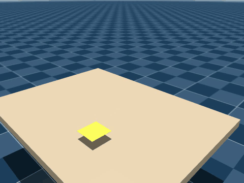
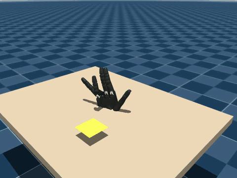

# Cup pick-and-place → Shadow Hand, from my own phone footage

**Akanksha Parija** — Awign x Armature AI Labs Humanoid Challenge submission.

Phone video of me
picking up a cup and placing it on a sticky note (and back) drives a
[Shadow Hand](https://github.com/google-deepmind/mujoco_menagerie/tree/main/shadow_hand)
(floating wrist) in MuJoCo, via hand-pose extraction → manual event
annotation → kinematic retargeting → physics replay with contact-based
grasp detection.

All data is mine: one continuous phone recording of my own hand, hand-split
into 63 trials and hand-annotated frame-by-frame.

## Results

| Trial | Grasp registered | Cup moved | On sticky note |
|---|---|---|---|
| `ep_007_t01` (good) | 31/71 frames, ≥2 fingertips | 10.4 cm | — |
| `ep_019_t01` (good) | 57/157 frames, ≥2 fingertips | 5.2 cm | — |
| `ep_033_t01` (good) | 34/111 frames, ≥2 fingertips | 1.5 cm | yes |
| `ep_011_t02` (failure) | 0/176 frames | 0 cm | no |





Across all 63 trials, replayed in the MuJoCo scene with real fingertip-contact
detection (no scripted "holding" flag):

- **55/63** trials register a grasp (≥2 fingertips touching the cup at some
  point). The cup is initialised at each trial's own annotated grasp frame,
  positioned at that frame's fingertip centroid — not at a real,
  independently-measured location — so this number validates hand shape and
  finger closure around a cup-sized object, not object localisation.
- **7/63** end with the cup within one sticky-note-width of the target
  location (heuristic — see [Limitations](#limitations); there is no
  camera-to-table calibration, so placement accuracy itself is not measured).
- The 8 trials with zero grasp frames are exactly the trials with the worst
  retargeting error (mean 35–76mm vs. the 42mm overall average) — the
  fingertips simply never get close enough to the cup for the
  ≥2-fingertip-contact threshold to fire. This is the retargeting error
  surfacing downstream, not a separate replay bug.

### Retargeting accuracy (63 trials, all episodes)

| Metric | Value |
|---|---|
| Mean fingertip error | 42.0 mm |
| Median fingertip error | 41.9 mm |
| Thumb error | 17.7 mm |
| Other 4 fingers, mean | 48.1 mm |
| Error vs. trial length, correlation (r) | 0.64 |

The thumb tracks far better than the other fingers (17.7mm vs. 44-51mm) even
though it has the least room for error during a wrap grip — see
[Occlusion analysis](#occlusion-analysis).

## Pipeline

```
phone video (one continuous take, camera static)
     │
     ▼
MediaPipe hand-pose extraction          scripts/extract_hands.py
     │  (4K downscaled to 1280px for detection)
     ▼
split into episodes (hand leaves frame) scripts/split_episodes.py
     │
     ▼
manual grasp/release annotation         scripts/annotate.py
     │  (63 trials: 32 to_target, 30 to_start; OpenCV keyboard tool,
     │   2 keystrokes per trial — g=grasp, r=release)
     ▼
build per-trial datasets + phase labels  scripts/build_trials.py
     │  (reach / grasp / transport / release / retreat)
     ▼
DexPilot/AnyTeleop-style retargeting     scripts/retarget.py
     │  (palm-frame alignment + bounded least-squares per frame,
     │   warm-started from the previous frame)
     ▼
MuJoCo scene: Shadow Hand + tapered cup  scripts/gen_scene.py, build_scene.py
     + sticky-note target on a table
     ▼
replay + fingertip-contact grasp check   scripts/replay.py
     │
     ▼
GIFs of good trials + a failure case     scripts/make_gifs.py
```

## Setup

```bash
python3 -m venv venv
source venv/bin/activate
pip install -r requirements.txt

git clone https://github.com/google-deepmind/mujoco_menagerie.git
```

`mujoco_menagerie/` and the raw video/keypoint intermediates are not
committed (see `.gitignore`) — `data/trials/` (the per-trial datasets) and
`outputs/qpos/` (retargeted joint angles, already computed) are small
enough to keep and are committed, so replay works right after cloning
without re-running the retargeter.

No ffmpeg is used anywhere; video I/O goes through OpenCV, GIFs through
Pillow.

## How to run

```bash
# 1. build the MuJoCo scene (tapered cup + sticky note, from config.py)
python scripts/gen_scene.py
python scripts/build_scene.py

# 2. retarget every trial onto the Shadow Hand (already run; outputs/qpos/ has the results)
python scripts/retarget.py data/trials outputs/qpos \
    --model mujoco_menagerie/shadow_hand/right_hand.xml

# 3. replay every trial with fingertip-contact grasp detection
python scripts/replay.py outputs/qpos \
    --scene mujoco_menagerie/shadow_hand/scene_cup.xml \
    --summary outputs/replay_summary.csv

# 4. render a specific trial to video, then to GIF
python scripts/replay.py outputs/qpos/ep_007_t01.json \
    --scene mujoco_menagerie/shadow_hand/scene_cup.xml \
    --out outputs/videos/ep_007_t01.mp4
python scripts/make_gifs.py outputs/videos/ep_007_t01.mp4 docs/gifs/ep_007_t01.gif
```

`PIPELINE.md` has the full step-by-step from raw phone footage onward
(extraction, splitting, annotation, trial-building) with the exact commands
and what to look for at each step.

## Occlusion analysis

Fingertip error correlates with trial length (r = 0.64) and the thumb tracks
far better than the other four fingers (17.7mm vs. 44–51mm, per-finger means:
index 44.4, middle 47.4, ring 50.5, little 50.2). Both point at
the same cause: during transport, the cup itself occludes the camera's view
of the fingers wrapped around it, and MediaPipe's detection confidence (and
accuracy) drops. The thumb is usually on the near/visible side of the grip in
this camera angle, which is why it survives occlusion better than the index
through little fingers, which end up on the far side, against or wrapped
around the cup. Longer trials simply spend more frames in that occluded
transport phase, so their error accumulates. This is a camera-angle and
occlusion limitation of a single static phone camera, not a bug in the
retargeting solve itself — the first-frame (fully visible, open-hand)
retargeting error is consistently sub-10mm; it's the mid-trial frames that
the correlation is driven by.

### What didn't work: aperture-based trial segmentation

`scripts/segment_trials.py` tries to find trial boundaries (and
reach/grasp/transport/release/retreat phases) automatically from the
thumb-to-fingertip distance ("aperture"). It does not work for this task: a
wrap-around cup grasp keeps the thumb roughly a cup-diameter from the other
fingertips throughout, so the aperture signal barely changes between "open
hand near the cup" and "hand holding the cup" — and the thumb is usually
occluded by the cup during the grasp anyway, which is the same occlusion
problem as above. `outputs/aperture.png` shows the flat, indistinct signal
that led to abandoning this approach in favor of manual annotation
(`scripts/annotate.py`), which the organizers specifically said they value
for quality.

## Limitations

- **"On sticky note" is a heuristic, not ground truth.** `wrist_pos` in the
  retargeted data comes straight from MediaPipe in the phone camera's own
  coordinate frame; there was no camera-to-table calibration captured during
  filming, so the scene's cup and sticky-note positions are placeholders,
  not measured locations. `replay.py` works around this by starting each
  trial's cup near the hand's own fingertips at the annotated grasp frame
  (so contact detection has something real to report), but "cup ends up near
  the sticky note" in the replay says more about whether the kinematic
  attach-on-contact logic tracked the hand correctly than about real-world
  placement accuracy. The headline metric that *is* trustworthy is the
  fingertip-contact grasp count, since that only depends on the relative
  geometry of the retargeted hand and the cup it's reaching for.
- **Kinematic mode doesn't test real contact dynamics.** The default replay
  mode teleports the cup to the fingertip centroid once ≥2 fingertips touch
  it; `--mode physics` leaves the cup to MuJoCo's contact solver instead.
  Run both and compare: physics mode drops to **31/63** trials registering
  a grasp (vs. 55/63 kinematic), and in many of those the cup is knocked
  tens of centimetres away rather than lifted, because the retargeted grip
  itself has ~40mm average fingertip error and an imprecise grip plus real
  contact dynamics mostly means a glancing hit, not a stable hold. Both
  modes are implemented (`--mode kinematic` / `--mode physics`); the
  physics numbers are the honest ones.
- **Occlusion, not solver error, is the main source of inaccuracy** — see
  above. A second camera angle or markers on the fingers would likely fix
  this more than any change to the retargeting math.

## What I'd do next

- A second, overhead or side, camera to resolve the occlusion during
  transport — this is the single biggest lever on the 42mm error.
- Calibrate the phone camera against the real table/cup/sticky-note layout
  so "on sticky note" becomes a real spatial check instead of a heuristic.
- Policy training on top of the retargeted demonstrations (not attempted
  here, per the challenge's own phasing — this submission is the data
  pipeline and simulated replay, not an RL policy).
