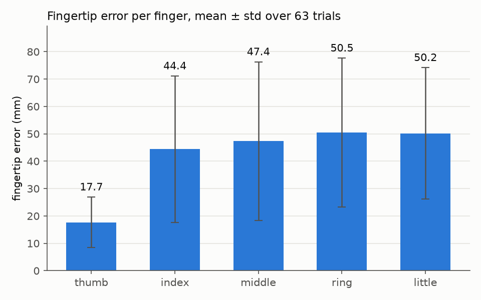
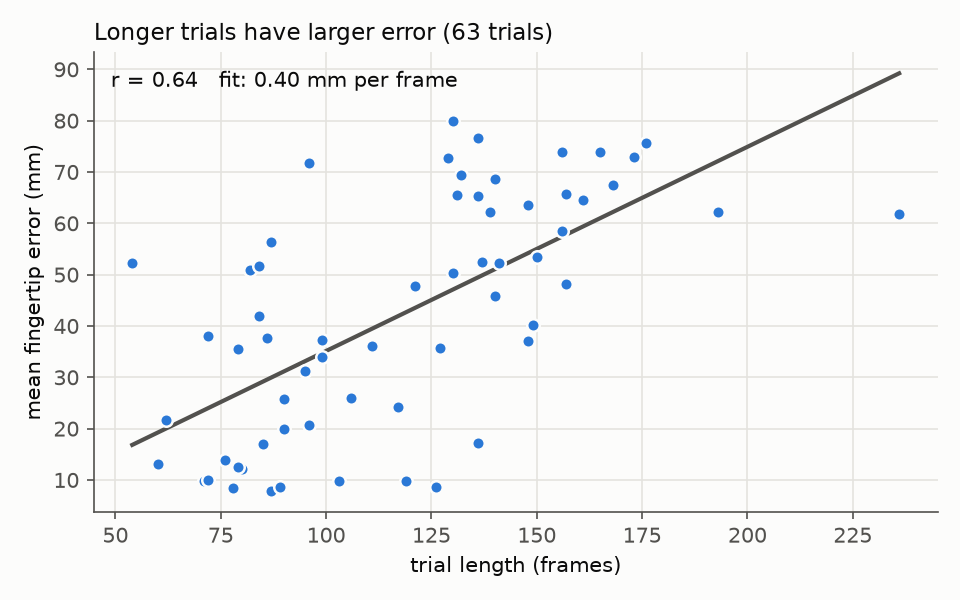
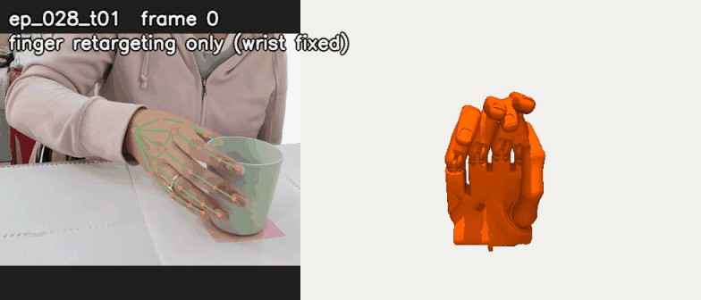
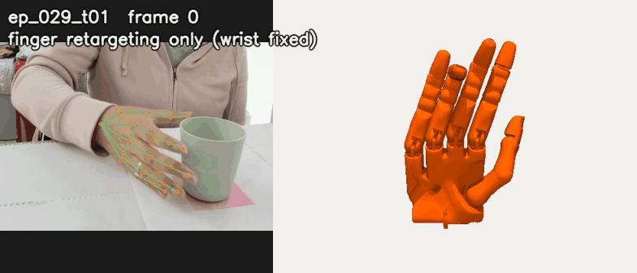
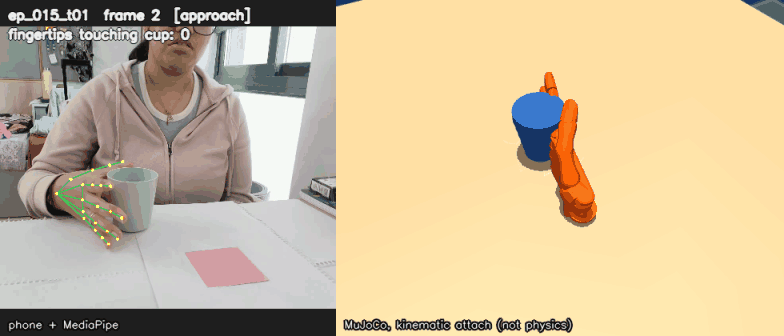
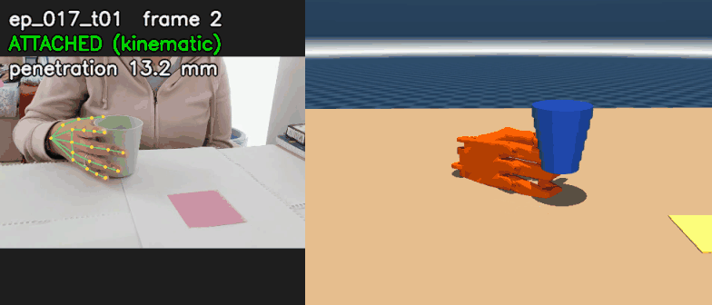

# Cup pick-and-place → Shadow Hand, from my own phone footage

**Akanksha Parija** — Awign x Armature AI Labs Humanoid Challenge submission.

Phone video of me
picking up a cup and placing it on a sticky note (and back) drives a
[Shadow Hand](https://github.com/google-deepmind/mujoco_menagerie/tree/main/shadow_hand)
(floating wrist) in MuJoCo, via hand-pose extraction → manual event
annotation → kinematic retargeting → replay with fingertip-contact
grasp detection.

All data is mine: one continuous phone recording of my own hand, hand-split
into 63 trials and hand-annotated frame-by-frame.

## Honest assessment

The hand motion is still not great. Mean fingertip error is 42mm, and for
four of the five fingers it is 44-51mm, only the thumb is good (17.7mm).
That is a real gap, not a rounding error, and I don't want to bury it.
This is the most meaningful number in the repo.

The main cause is camera occlusion, not a bug in the retargeting solve. One
static phone camera means the cup blocks the view of the fingers wrapped
around it during transport, and tracking quality drops right when it
matters most. The thumb usually stays on the visible side of the grip in
this camera angle, which is why it alone tracks well.

I tried to fix this with temporal smoothing (Savitzky-Golay on the
landmarks, then re-run through the same retargeting code). Jitter went
down: mean joint velocity dropped about 6% and acceleration about 12%. But
fingertip error stayed exactly the same, 42.0mm before and after, because
smoothing cleans up noise, not a camera-angle bias. The contact-based grasp
count barely moves (kinematic 63/63 → 62/63, physics 62/63 → 61/63, one
trial each). Since the accuracy number doesn't improve, I kept the original,
unsmoothed data as the one used everywhere in this repo. Full numbers in
[outputs/retarget_smoothed/NOTES.md](outputs/retarget_smoothed/NOTES.md).

The replay grasp counts are much weaker evidence than the 42mm number, see
[Which number comes from where](#which-number-comes-from-where).

## Key numbers

### Retargeting accuracy (63 trials, all episodes)

| Metric | Value |
|---|---|
| Mean fingertip error | 42.0 mm |
| Median fingertip error | 41.9 mm |
| Thumb error | 17.7 mm |
| Other 4 fingers, mean | 48.1 mm |
| Error vs. trial length, correlation (r) | 0.64 |



The thumb's error is 17.7 ± 9.2 mm, while the other four fingers average
44.4-50.5 mm, with standard deviations of 24.0-28.9 mm across the 63 trials.

The thumb tracks far better than the other fingers (17.7mm vs. 44-51mm) even
though it has the least room for error during a wrap grip — see
[Occlusion analysis](#occlusion-analysis).

### Occlusion analysis



Across the 63 trials (54-236 frames long), mean fingertip error rises by
0.40 mm per frame of trial length on the fit line, with r = 0.64.

Fingertip error correlates with trial length (r = 0.64) and the thumb tracks
far better than the other four fingers (17.7mm vs. 44–51mm, per-finger means:
index 44.4, middle 47.4, ring 50.5, little 50.2). Both point at
the same cause: during transport, the cup itself occludes the camera's view
of the fingers wrapped around it, and MediaPipe's detection confidence (and
accuracy) drops. The thumb is usually on the near/visible side of the grip in
this camera angle, which is why it survives occlusion better than the index
through little fingers, which end up on the far side, against or wrapped
around the cup. Longer trials simply spend more frames in that occluded
transport phase, so their error accumulates. This is a camera-angle and
occlusion limitation of a single static phone camera, not a bug in the
retargeting solve itself — the first-frame (fully visible, open-hand)
retargeting error is consistently sub-10mm; it's the mid-trial frames that
the correlation is driven by.

#### What didn't work: aperture-based trial segmentation

`scripts/segment_trials.py` tries to find trial boundaries (and
reach/grasp/transport/release/retreat phases) automatically from the
thumb-to-fingertip distance ("aperture"). It does not work for this task: a
wrap-around cup grasp keeps the thumb roughly a cup-diameter from the other
fingertips throughout, so the aperture signal barely changes between "open
hand near the cup" and "hand holding the cup" — and the thumb is usually
occluded by the cup during the grasp anyway, which is the same occlusion
problem as above. `outputs/aperture.png` shows the flat, indistinct signal
that led to abandoning this approach in favor of manual annotation
(`scripts/annotate.py`), which the organizers specifically said they value
for quality.

## Replay examples

### Finger retargeting replay

Phone footage with the MediaPipe landmarks (left) next to the Shadow Hand
(right) with its **wrist held in one fixed pose** (fingers up, palm towards
the camera, hand centred). Only the retargeted finger joint angles for that
trial move it: no cup, no wrist translation or rotation, the same camera
for both clips. This isolates the finger retargeting from the approximate
wrist trajectory and the cup. Rendered by `scripts/make_finger_gifs.py`
with the same face-line and visibility checks as the cup clips. Only frames
where MediaPipe actually detected my hand are shown, with no interpolated
tracking.

#### `ep_028_t01` — clearest open → close → open cycle



Frames 0-72 of 86 (all detected). Mean finger flexion over the clip goes
from 0.16 to 0.68 of joint range, and the trial's retargeting error is
37.6 mm.

#### `ep_029_t01` — largest continuous open → close



Frames 0-70 of 84 (all detected). Mean finger flexion goes from 0.13 to
0.80 of joint range, and the trial's retargeting error is 51.6 mm.

**How these two were chosen.** For every trial I took the mean flexion of
the non-thumb finger joints (J1–J3, each as a fraction of its range) and
its 5th-95th percentile range over the trial (median 0.27 across the 63
trials). I also took tracking confidence: the share of frames MediaPipe
actually detected. The trials with the largest raw range are not shown:
`ep_024_t03` (0.67) and `ep_011_t02` (0.58). Their flexion joints sit
exactly at a joint limit in 90% and 73% of frames and jump between limits
in steps rather than moving. `ep_028_t01` (range 0.52, at a limit 48% of
the time) and `ep_029_t01` (range 0.67, 68%) move continuously.

One thing that came out of this: across all 63 trials, the fraction of
finger flexion joint-frames sitting at a joint limit (median 51%)
correlates with retargeting error at r = 0.97. That is a correlation, not a
diagnosis. Pinned joints could come from occluded, bad landmark targets or
from a hand-size mismatch in the retargeting. I didn't investigate further
here.

### Qualitative replay with kinematic attach (phone view)

Each clip is phone footage with the MediaPipe landmarks drawn on it (left)
synced frame-by-frame against the MuJoCo replay (right), rendered by
`scripts/make_result_gifs.py` from the phone's own viewing direction. It
covers the annotated grasp-to-release span, with up to 15 frames before and
after. The overlay shows the trial and frame, and while the cup is attached,
"ATTACHED (kinematic)" with the live hand-cup penetration in mm.

**Cup is attached to the fingertips by kinematic attach mode once ≥2
fingertips touch it, and released at the annotated release frame. This is
not physics-based carrying. Physics mode reaches ≥2 fingertip contacts in
62/63 trials, but that counts contact, not a lift (see below).**

The hand's orientation comes from the data: the palm frame in the image
landmarks, through one fixed camera-to-sim rotation (see
[Hand orientation](#hand-orientation)). The hand's position is the
approximate image-based trajectory, so the pose relative to the cup is
still approximate. The grasp shape and contact counts are the meaningful
part.

#### `ep_015_t01` — clean case: penetration 0.1 mm mean, 0.4 mm max

This is a **flat-hand contact with nearly straight fingers**, not a wrap:
mean finger flexion at the grasp is 0.04 of joint range, so the cup rests
against flat fingers. ≥2 fingertips are within 5 mm of the cup in 97% of
the 118 attached frames. Attached from frame 0 (before the clip's first
frame) to the annotated release at frame 118; the annotated grasp is
frame 17.



#### `ep_017_t01` — typical case: penetration 4.1 mm mean, 13.2 mm max

This shows the **typical curled grasp with residual overlap**: the fingers
are curled (flexion 0.55) and sink into the cup in some frames, and ≥2
fingertips are within 5 mm in 92% of the 121 attached frames. (Over just
the frames shown in the clip, the mean is 4.2 mm and 93%.) Attached from
frame 0 to the annotated release at frame 121; the annotated grasp is
frame 17.



There is no failure clip. Every trial reaches ≥2 fingertip contacts in
kinematic mode, so there is no honest "contact never happens" kinematic
case left to show. The one trial that never reaches ≥2 contacts in physics
mode is `ep_034_t02`.

#### How the attach works, and residual penetration

**Kinematic attach does not resolve collisions.** The fingers come from my
human hand retargeted onto a Shadow Hand with different proportions
(~42 mm fingertip error), so they don't close around a real 7.5 cm cup the
way mine did, and the cup and fingers overlap. Once the cup attaches, it is
held fixed in the palm frame at the one offset per trial that minimises
that overlap while keeping ≥2 fingertips within 5 mm of the cup surface in
at least 90% of attached frames (`scripts/attach_fit.py`). Only the cup's
position is fitted: it is symmetric about its own axis, so rotating it
about that axis changes nothing. Finger joint angles are never changed.

Residual penetration over the attached frames of all 63 trials (deepest
overlap between any hand collision geom and the cup, per frame, from
`mj_geomDistance`; in `outputs/replay_summary.csv`):

| Mean | Worst frame | Median per-trial max | ≥2 fingertips within 5 mm |
|---|---|---|---|
| **9.7 mm** | **23.3 mm** | **16.7 mm** | **90% of frames** |

Only 5 of 63 trials get below 5 mm max (`ep_015_t01`, `ep_024_t03`,
`ep_029_t01`, `ep_030_t02`, `ep_047_t01`). The deepest overlaps are the
ring and little fingers curling into the cup: the retargeted hand closes
tighter than the cup is wide, so no single offset clears every finger.

The hand moves across the table, not just rotating in place: its wrist
trajectory is recovered approximately from the phone image (see
[Approximate wrist trajectory](#approximate-wrist-trajectory)).

#### What the clips do not show

- **The sticky note is staged.** There is no camera-to-table calibration of
  the note's *position*, so the table is placed under the cup's starting
  point and the sticky note is drawn where the cup is released. The cup
  does not land on the real sticky note's location. (Only the table's
  *tilt* is measured, see [Hand orientation](#hand-orientation).)
- **The travel distance is not measured.** The cup moves 19.3cm and 21.1cm
  in these clips. Those distances scale directly with the assumed focal
  length and hand size, and the trajectory's error has not been measured,
  so they are not real distances. The direction is the trustworthy part
  (see below).
- **The table is not a constraint on the hand.** The replayed hand can dip
  below the staged table top, and a cup held in the palm frame dips with
  it. The clips were chosen so the carried cup never sinks more than 1 cm
  into the table.

#### Checks and how the clips were chosen

Automatic checks on every frame of every clip:

- **Sim visibility:** the palm and 5 fingertips are projected into the image
  and must land inside it, and the frame is re-rendered with the hand
  hidden to confirm ≥2% of pixels change (≥95% of frames must pass).
- **Hand never leaves the frame:** each clip is trimmed to the longest run
  of frames around the attached span in which the projected hand stays
  inside the sim image *and* all 21 hand landmarks stay inside the phone
  crop. A trial is rejected if the attached span itself fails.
- **No face:** the phone camera is static, and my chin sits at about
  y = 110-140 px (of 720) in every frame. I read that off the footage by
  hand. The phone crop never starts above y = 200 px, and frames where any
  hand landmark rises above that line are trimmed. I tried OpenCV's Haar
  face detectors as an extra check, but they can't find my partly cropped
  face even in the band where it is, so they prove nothing and aren't used.
- **Penetration:** below 5 mm max for the clean clip.
- **Labels:** "ATTACHED" and the penetration number come from the sim's
  attach state, and the script asserts they only appear from the attach
  frame to the annotated release frame. `replay.py`'s rule can attach
  *before* the annotated grasp, because the fingertips already touch the cup
  where it is placed, so each caption lists the attach, annotated grasp and
  annotated release frames.

**Choosing the clips.** I rendered all 32 to_target trials with every check.
30 pass the visibility check, 6 never sink the cup into the table, and only
`ep_015_t01` passes every check including the 5 mm limit. I also measured
how curled the fingers are at the annotated grasp frame: the mean of the
non-thumb flexion joints (J1–J3), as a fraction of each joint's range. The
median is 0.48. Many trials are much flatter than my real hand was:
`ep_015_t01` is at 0.04, with nearly straight fingers, even though my
fingers clearly wrap the cup in the footage. That's the retargeting losing
the curl, likely the same occlusion problem as the 42 mm error, and it's
part of why this trial overlaps the cup so little. `ep_017_t01`
(flexion 0.55) has the lowest penetration of the clearly curled trials
that pass every other check, so it is the typical case.

**Camera.** One camera setting for every clip: the phone's own viewing
direction (azimuth 89°, elevation −17.5°, from the measured camera-to-sim
rotation), 0.5 m from a look-at point that follows the palm. It is closer
than the real phone so the hand is readable, but it looks the same way.

### Hand orientation

The hand's orientation in the sim comes from the data, with no per-clip
heuristic (`scripts/wrist_traj.py`, `to_sim_palm`):

- **Palm frame from the image landmarks plus MediaPipe depth.** Per frame:
  y = wrist → middle knuckle, x = little knuckle → index knuckle (made
  orthogonal to y), z = x × y. The points are the image landmarks
  back-projected with MediaPipe's per-landmark relative depth. The world
  landmarks were tried first and aren't usable here: their palm normal
  agreed with the image on which way the palm faces in only 56% of frames,
  and a per-frame PnP fit of their 3D shape onto the image was no better
  (48%). The image-based frame agrees in 99.3% of frames.
- **One fixed camera-to-sim rotation for every clip, including the phone's
  tilt.** The sticky note is a known 7.5 cm square on the table. Its four
  corners, found by colour, and a PnP solve (0.6-2.1 px reprojection in 6
  clips; `scripts/measure_table_plane.py`) give the table plane: the phone
  looks 17.5° below horizontal (spread 0.8° across clips). Sim "up" is that
  table normal.
- **One fixed offset to the Shadow Hand**, from the model's own wrist and
  knuckles built the same way. It's determined once, not per trial.
- **Handedness check:** the fingertips sit on the palm (+z) side in 100% of
  grasp frames, the same convention as the Shadow right hand, so my video
  is a non-mirrored right hand and nothing is flipped.
- Light forward-backward slerp smoothing on the rotation.

Checked against the phone with a virtual camera placed where the phone is
(`scripts/orient_check.py`), over all 63 trials (7392 frames):

| | Mean | Median | p95 | Max |
|---|---|---|---|---|
| Palm normal, sim vs landmarks | 3.5° | 0.5° | 25.6° | 57.7° |
| Wrist + 4 knuckles reprojected vs MediaPipe | 34.9 px | 33.0 px | 61.9 px | 181.6 px |

Two things inflate these numbers. The Shadow palm is larger than the
assumed 9.5 cm hand (wrist → knuckles 12.8 cm), so its knuckles land
further out than mine. And the smoothing lags fast wrist turns, which is
where the large angles are.

### Which number comes from where

| Number | Produced by | What it means |
|---|---|---|
| **42.0mm** mean fingertip error | `retarget.py` → `outputs/retarget_summary.csv` | How far the robot fingertips are from my (scaled) fingertips. The real accuracy number. |
| **63/63** trials with ≥2 fingertips on the cup | `replay.py --mode kinematic` → `outputs/replay_summary.csv` | Weak: the cup is placed at the hand's own fingertip centroid at the annotated grasp frame, so this mostly shows the fingertips close around that spot. Not object localisation. |
| **9.7 mm** mean, **23.3 mm** worst hand-cup penetration | `replay.py --mode kinematic` → `outputs/replay_summary.csv` (`pen_mean_mm`, `pen_max_mm`) | Residual overlap after the attach fit, over all attached frames. |
| **62/63** trials with ≥2 fingertips on the cup | `replay.py --mode physics` → `outputs/replay_summary_physics.csv` | Same seeding, but the cup is moved only by contact forces and gravity. It's the more meaningful replay number, and it counts contact at some frame, not a held lift: the median trial has ≥2-tip contact in 22% of its frames. |
| **0/63** cup ends on the sticky note (both modes) | both replay modes | Placeholder target, no calibration: meaningless, see Limitations. |
| GIF clips | `make_result_gifs.py` (same attach and fit as kinematic mode, released at the annotated frame) | Illustration. The penetration in each caption is measured on that clip's own frames and matches its row in `replay_summary.csv`. |

All replay numbers use the approximate wrist trajectory and the
data-driven hand orientation (`--wrist image --orient palm`, the defaults). Both counts are near the ceiling because of the seeding. The
real difference shows in how long contact lasts: kinematic mode holds the
cup in the palm once it is touched, while in physics, with an imprecise
grip (~42mm error), ≥2-tip contact holds for a median 22% of frames.

A note on "contact": every geom has a contact margin of 0, so MuJoCo only
reports a fingertip contact while the fingertip actually penetrates the
cup. The ≥2-contact counts above use that, as before. The attach fit and
the penetration columns instead count a fingertip as touching when its
surface is within 5 mm of the cup. In physics mode the cup starts at the fingertips with
nothing under it (the scene's table is not under the hand's coordinates),
so gravity acts on it from the first frame.

### Approximate wrist trajectory

MediaPipe's world landmarks, which the retargeting uses, are centred on the
hand, so they don't contain where the hand is. `scripts/wrist_traj.py` puts
the wrist back in the phone camera's frame from the image landmarks with a
pinhole model:

- **Depth from apparent hand size.** Depth = f × L / (length in pixels),
  for two bones with assumed typical lengths: wrist → middle-finger knuckle
  9.5 cm, index knuckle → little knuckle 7.5 cm. A bone tilted towards the
  camera only ever looks shorter, so each gives an upper bound on depth and
  I take the smaller one. Using the first bone alone was far too noisy,
  because in this camera angle it often points almost straight at the lens.
- **Assumed focal length, not calibrated:** f = 924 px at the 1280×720
  detection resolution. That is a typical phone main camera (26 mm
  35mm-equivalent, about 69° horizontal field of view). I don't know my
  phone's exact value for video.
- **Depth wobble clamp (an assumption):** within one trial the hand stays
  roughly the same distance from the phone, since the cup moves sideways
  across the table. So depth is clipped to the trial's median depth ±8 cm
  before smoothing. This cut the median per-trial depth range from about
  30 cm to 16 cm.
- Lightly smoothed (moving average, 9 frames for x/y, 15 for depth) and
  rotated with the same fixed camera-to-sim rotation as the orientation
  (see [Hand orientation](#hand-orientation)). The model's wrist body (not
  the forearm origin 21 cm behind it) is put on the estimated wrist.
- **Floor anchor (an assumption):** at about 0.7 m from the lens, the
  rotated trajectory lands under the sim floor. So each trial is shifted by
  one constant to put the wrist at the grasp frame 0.6 m above the floor,
  clear of the scene's placeholder table (top at 0.30 m). A rigid shift
  doesn't change hand-cup contact, but it does decide where the floor and
  the placeholder table are for physics mode.

**The accuracy of this trajectory is not measured.** Depth still varies
(median per-trial range 16 cm after the clamp, 5th-95th percentile depth
0.58-0.86 m), and every distance scales with the assumed focal length and
hand size. What it does get right is the direction: the wrist moves
image-right on 32/32 to_target trials and image-left on 30/30 to_start
trials, matching the task.

## Bug found and fixed

While reworking the GIFs I found that the replay was writing joint angles
into the wrong slots. The retargeter solves in `right_hand.xml`, which has
no free joint, so its saved joint addresses start at `qpos[2]`. The replay
scene uses a free-floating copy of the hand, where the free joint takes
`qpos[0:7]` and every finger joint sits 7 slots later. `replay.py` used the
saved addresses directly, so finger angles were written into the wrist
position/orientation and every finger joint got the angle meant for
the joint 7 places further along. That's why the sim hand used to jump around and leave the shot.

`replay.py` now looks joints up by name (`Replayer.scene_qpos_adr`). The
earlier grasp numbers (computed with the scrambled joints) are gone from
this README and every replay CSV was regenerated. The retargeting error
(42mm) was not affected: it is solved and measured in `right_hand.xml`,
where the addresses were always right.

## Pipeline

```
phone video (one continuous take, camera static)
     │
     ▼
MediaPipe hand-pose extraction          scripts/extract_hands.py
     │  (4K downscaled to 1280px for detection)
     ▼
split into episodes (hand leaves frame) scripts/split_episodes.py
     │
     ▼
manual grasp/release annotation         scripts/annotate.py
     │  (63 trials: 32 to_target, 30 to_start; OpenCV keyboard tool,
     │   2 keystrokes per trial — g=grasp, r=release)
     ▼
build per-trial datasets + phase labels  scripts/build_trials.py
     │  (reach / grasp / transport / release / retreat)
     ▼
DexPilot/AnyTeleop-style retargeting     scripts/retarget.py
     │  (palm-frame alignment + bounded least-squares per frame,
     │   warm-started from the previous frame)
     ▼
MuJoCo scene: Shadow Hand + tapered cup  scripts/gen_scene.py, build_scene.py
     + sticky-note target on a table
     ▼
replay + fingertip-contact grasp check   scripts/replay.py
     │
     ▼
GIFs (kinematic attach, visibility check) scripts/make_result_gifs.py
     + finger-only GIFs (wrist fixed)     scripts/make_finger_gifs.py
```

## Setup

```bash
python3 -m venv venv
source venv/bin/activate
pip install -r requirements.txt

git clone https://github.com/google-deepmind/mujoco_menagerie.git
```

`mujoco_menagerie/` and the raw video/keypoint intermediates are not
committed (see `.gitignore`) — `data/trials/` (the per-trial datasets) and
`outputs/qpos/` (retargeted joint angles, already computed) are small
enough to keep and are committed, so replay works right after cloning
without re-running the retargeter.

No ffmpeg is used anywhere; video I/O goes through OpenCV, GIFs through
Pillow.

## How to run

```bash
# 1. build the MuJoCo scene (tapered cup + sticky note, from config.py)
python scripts/gen_scene.py
python scripts/build_scene.py

# 2. retarget every trial onto the Shadow Hand (already run; outputs/qpos/ has the results)
python scripts/retarget.py data/trials outputs/qpos \
    --model mujoco_menagerie/shadow_hand/right_hand.xml

# 3. replay every trial with fingertip-contact grasp detection, both modes
python scripts/replay.py outputs/qpos \
    --scene mujoco_menagerie/shadow_hand/scene_cup.xml \
    --summary outputs/replay_summary.csv
python scripts/replay.py outputs/qpos \
    --scene mujoco_menagerie/shadow_hand/scene_cup.xml \
    --mode physics --summary outputs/replay_summary_physics.csv

# 4. render a specific trial to video, then to GIF (generic, any trial)
python scripts/replay.py outputs/qpos/ep_007_t01.json \
    --scene mujoco_menagerie/shadow_hand/scene_cup.xml \
    --out outputs/videos/ep_007_t01.mp4
python scripts/make_gifs.py outputs/videos/ep_007_t01.mp4 outputs/videos/ep_007_t01.gif

# 5. regenerate the README figures from outputs/retarget_summary.csv
python scripts/plot_figures.py

# 6. regenerate the README gifs (prints every per-clip check: visibility,
#    trimming, face line, penetration; --trials ep_xxx_tyy ... to try others)
python scripts/make_result_gifs.py      # cup clips (kinematic attach)
python scripts/make_finger_gifs.py      # finger retargeting clips (wrist fixed)
```

`PIPELINE.md` has the full step-by-step from raw phone footage onward
(extraction, splitting, annotation, trial-building) with the exact commands
and what to look for at each step.

## Limitations

- **The wrist trajectory is a monocular approximation.** Depth comes from
  apparent hand size with an assumed focal length (924 px) and assumed bone
  lengths (9.5 cm, 7.5 cm). There's no calibration, and its error isn't
  measured. See [Approximate wrist trajectory](#approximate-wrist-trajectory).
- **"On sticky note" is a heuristic, not ground truth.** There was no
  camera-to-table calibration captured during filming, so the scene's cup
  and sticky-note positions are placeholders, not measured locations.
  `replay.py` starts each trial's cup at the hand's own fingertips at the
  annotated grasp frame, so contact detection has something real to report,
  but the cup never ends within a sticky-note width of the placeholder
  target (0/63 in both modes), which says nothing about real-world
  placement accuracy.
- **The grasp counts are seeded.** Because the cup starts at the fingertip
  centroid, ≥2-fingertip contact is close to guaranteed in kinematic mode
  (63/63). The kinematic mode holds the cup in the palm once ≥2 fingertips
  touch it; `--mode physics` leaves the cup to MuJoCo's contact solver
  instead (62/63 reach contact, median 22% of frames in contact). Neither
  is evidence of a stable, physically held lift.
- **Kinematic attach does not resolve collisions.** The fingers come from a
  human hand retargeted onto a different hand, and the residual hand-cup
  penetration is 9.7 mm mean and 23.3 mm max over all attached frames
  (only 5/63 trials are below 5 mm max).
- **Occlusion, not solver error, is the main source of inaccuracy** — see
  above. A second camera angle or markers on the fingers would likely fix
  this more than any change to the retargeting math.
- **Temporal smoothing reduces jitter but not error.** See
  [Honest assessment](#honest-assessment) and
  [outputs/retarget_smoothed/NOTES.md](outputs/retarget_smoothed/NOTES.md)
  for the full before/after numbers — the attempt is kept in the repo for
  the record, but `outputs/qpos` (unsmoothed) is what everything else here
  uses.

## What I'd do next

- A second, overhead or side, camera to resolve the occlusion during
  transport — this is the single biggest lever on the 42mm error.
- Calibrate the phone camera (focal length, plus a checkerboard on the
  table) so the wrist trajectory has a measured error and real distances,
  and constrain the replayed hand to stay above the table.
- Calibrate the phone camera against the real table/cup/sticky-note layout
  so "on sticky note" becomes a real spatial check instead of a heuristic.
  The table's tilt is already measured from the sticky note; its position
  isn't.
- Policy training on top of the retargeted demonstrations (not attempted
  here, per the challenge's own phasing — this submission is the data
  pipeline and simulated replay, not an RL policy).
