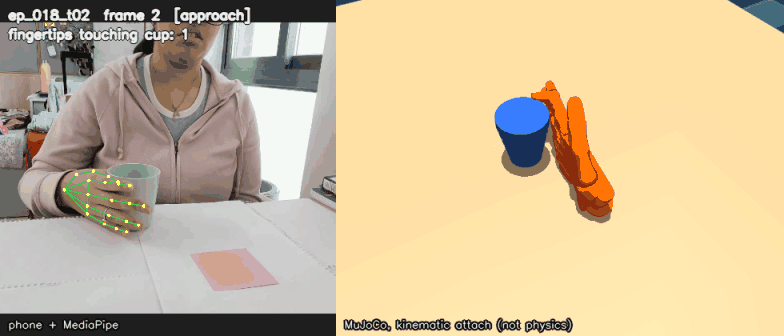
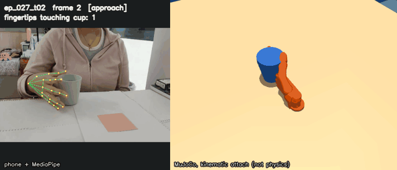

# Cup pick-and-place → Shadow Hand, from my own phone footage

**Akanksha Parija** — Awign x Armature AI Labs Humanoid Challenge submission.

Phone video of me
picking up a cup and placing it on a sticky note (and back) drives a
[Shadow Hand](https://github.com/google-deepmind/mujoco_menagerie/tree/main/shadow_hand)
(floating wrist) in MuJoCo, via hand-pose extraction → manual event
annotation → kinematic retargeting → replay with fingertip-contact
grasp detection.

All data is mine: one continuous phone recording of my own hand, hand-split
into 63 trials and hand-annotated frame-by-frame.

## Honest assessment

The hand motion is still not great. Mean fingertip error is 42mm, and for
four of the five fingers it is 44-51mm, only the thumb is good (17.7mm).
That is a real gap, not a rounding error, and I don't want to bury it.
This is the most meaningful number in the repo.

The main cause is camera occlusion, not a bug in the retargeting solve. One
static phone camera means the cup blocks the view of the fingers wrapped
around it during transport, and tracking quality drops right when it
matters most. The thumb usually stays on the visible side of the grip in
this camera angle, which is why it alone tracks well.

I tried to fix this with temporal smoothing (Savitzky-Golay on the
landmarks, then re-run through the same retargeting code). Jitter went
down: mean joint velocity dropped about 6% and acceleration about 12%. But
fingertip error stayed exactly the same, 42.0mm before and after, because
smoothing cleans up noise, not a camera-angle bias. The contact-based grasp
count also went slightly down (63/63 to 62/63 kinematic, 62/63 to 61/63
physics). So I kept the original, unsmoothed data as the one used
everywhere in this repo. Full numbers in
[outputs/retarget_smoothed/NOTES.md](outputs/retarget_smoothed/NOTES.md).

The replay grasp counts are much weaker evidence than the 42mm number, see
[Which number comes from where](#which-number-comes-from-where).

## Bug found and fixed

While reworking the GIFs I found that the replay was writing joint angles
into the wrong slots. The retargeter solves in `right_hand.xml`, which has
no free joint, so its saved joint addresses start at `qpos[2]`. The replay
scene uses a free-floating copy of the hand, where the free joint takes
`qpos[0:7]` and every finger joint sits 7 slots later. `replay.py` used the
saved addresses directly, so finger angles were written into the wrist
position/orientation and every finger joint got the angle meant for
the joint 7 places further along. That's why the sim hand used to jump around and leave the shot.

`replay.py` now looks joints up by name (`Replayer.scene_qpos_adr`). The
earlier grasp numbers (computed with the scrambled joints) are gone from
this README and every replay CSV was regenerated. The retargeting error
(42mm) was not affected: it is solved and measured in `right_hand.xml`,
where the addresses were always right.

## Results

Each clip is phone footage with the MediaPipe landmarks drawn on it (left)
synced frame-by-frame against the MuJoCo replay (right), rendered by
`scripts/make_result_gifs.py`. It shows the full annotated grasp-to-release
span, plus 15 frames of approach before and 15 frames after.

**Cup is attached to the fingertips by kinematic attach mode once ≥2
fingertips touch it, and released at the annotated release frame. This is
not physics-based carrying. Physics mode reaches ≥2 fingertip contacts in
62/63 trials, but that counts contact, not a lift (see below).**

The hand now moves across the table, not just rotating in place: its wrist
trajectory is recovered approximately from the phone image (see
[Approximate wrist trajectory](#approximate-wrist-trajectory)).

Other things the clips do *not* show:

- **The sticky note is staged.** There is no camera-to-table calibration,
  so the table is placed under the cup's starting point and the sticky note
  is drawn where the cup is released. The cup does not land on the real
  sticky note's location.
- **The travel distance is not measured.** The cup moves 42.6cm, 44.0cm
  and 51.0cm in these clips. Those distances scale directly with the
  assumed focal length and hand size, and the trajectory's error has not
  been measured, so they are not real distances. The direction is the
  trustworthy part: across all 32 to_target trials the sim cup moves
  image-right, the way my real cup went, in 32/32 (23/32 before, when the
  hand only rotated in place).
- **The table is not a constraint on the hand.** The replayed hand often
  dips below the staged table top. While attached, the cup is held at the
  table top instead of sinking through it (4/155 frames in `ep_018_t02`,
  11/171 in `ep_027_t02`, 17/127 in `ep_015_t01`), so in those frames it
  slides along the table.
- **"Up" is inferred.** The data is in the phone camera's axes. Each trial
  is rotated once so the little→index knuckle line at the grasp frame is
  vertical (in a side wrap grasp the cup's axis runs along it), so the cup
  stands upright in the grip. `replay.py` uses the same rotation, so the
  clips and the replay numbers come from the same hand pose.

Every frame is checked automatically: the palm and 5 fingertips are
projected into the image and must land inside it, and the frame is
re-rendered with the hand hidden to confirm ≥2% of pixels change. I
rendered all 32 to_target trials with one camera setting: 18 pass on ≥95%
of frames (2 did when the hand only rotated in place). These three move the
cup furthest while rarely needing the table clamp.

#### `ep_018_t02` — hand visible in 96.8% of frames



#### `ep_027_t02` — hand visible in 97.1% of frames



#### `ep_015_t01` — hand visible in 96.1% of frames


There is no failure clip. With the joint mapping fixed, every trial reaches
≥2 fingertip contacts in kinematic mode, so there is no honest "contact
never happens" kinematic case left to show. The one trial that never
reaches ≥2 contacts in physics mode is `ep_035_t01`.

### Which number comes from where

| Number | Produced by | What it means |
|---|---|---|
| **42.0mm** mean fingertip error | `retarget.py` → `outputs/retarget_summary.csv` | How far the robot fingertips are from my (scaled) fingertips. The real accuracy number. |
| **63/63** trials with ≥2 fingertips on the cup | `replay.py --mode kinematic` → `outputs/replay_summary.csv` | Weak: the cup is placed at the hand's own fingertip centroid at the annotated grasp frame, so this mostly shows the fingertips close around that spot. Not object localisation. |
| **62/63** trials with ≥2 fingertips on the cup | `replay.py --mode physics` → `outputs/replay_summary_physics.csv` | Same seeding, but the cup is moved only by contact forces and gravity. It's the more meaningful replay number, and it counts contact at some frame, not a held lift: the median trial has ≥2-tip contact in 11% of its frames (27% in kinematic mode). |
| **1/63** (kinematic), **0/63** (physics) cup ends on the sticky note | both replay modes | Placeholder target, no calibration: meaningless, see Limitations. |
| GIF clips | `make_result_gifs.py` (kinematic attach, released at the annotated frame) | Illustration only. No reported number is computed from them. |

All replay numbers use the approximate wrist trajectory (`--wrist image`,
the default). Both counts are near the ceiling because of the seeding. The real
difference shows in how long contact lasts: kinematic mode freezes the cup
to the fingertips once it is touched, while in physics, with an imprecise
grip (~42mm error), ≥2-tip contact holds for a median 11% of frames. In physics mode the cup starts at the fingertips with
nothing under it (the scene's table is not under the hand's coordinates),
so gravity acts on it from the first frame.

### Approximate wrist trajectory

MediaPipe's world landmarks, which the retargeting uses, are centred on the
hand, so they don't contain where the hand is. `scripts/wrist_traj.py` puts
the wrist back in the phone camera's frame from the image landmarks with a
pinhole model:

- **Depth from apparent hand size.** Depth = f × L / (length in pixels),
  for two bones with assumed typical lengths: wrist → middle-finger knuckle
  9.5 cm, index knuckle → little knuckle 7.5 cm. A bone tilted towards the
  camera only ever looks shorter, so each gives an upper bound on depth and
  I take the smaller one. Using the first bone alone was far too noisy,
  because in this camera angle it often points almost straight at the lens.
- **Assumed focal length, not calibrated:** f = 924 px at the 1280×720
  detection resolution. That is a typical phone main camera (26 mm
  35mm-equivalent, about 69° horizontal field of view). I don't know my
  phone's exact value for video.
- Lightly smoothed (moving average, 9 frames for x/y, 15 for depth),
  rotated with the same knuckle-up rotation, and shifted by one constant so
  the wrist at the grasp frame sits 0.6 m above the floor. The model's
  wrist body (not the forearm origin 21 cm behind it) is put on the
  estimated wrist.

**The accuracy of this trajectory is not measured.** Depth still wobbles a
lot (median per-trial depth range ~30 cm on to_target trials), and every
distance scales with the assumed focal length and hand size. What it does
get right is the direction: the wrist moves image-right on 32/32 to_target
trials and image-left on 30/30 to_start trials, matching the task. Physics
mode is barely affected (62/63, vs 63/63 with the hand rotating in place in
the same frame).

### Retargeting accuracy (63 trials, all episodes)

| Metric | Value |
|---|---|
| Mean fingertip error | 42.0 mm |
| Median fingertip error | 41.9 mm |
| Thumb error | 17.7 mm |
| Other 4 fingers, mean | 48.1 mm |
| Error vs. trial length, correlation (r) | 0.64 |

The thumb tracks far better than the other fingers (17.7mm vs. 44-51mm) even
though it has the least room for error during a wrap grip — see
[Occlusion analysis](#occlusion-analysis).

## Pipeline

```
phone video (one continuous take, camera static)
     │
     ▼
MediaPipe hand-pose extraction          scripts/extract_hands.py
     │  (4K downscaled to 1280px for detection)
     ▼
split into episodes (hand leaves frame) scripts/split_episodes.py
     │
     ▼
manual grasp/release annotation         scripts/annotate.py
     │  (63 trials: 32 to_target, 30 to_start; OpenCV keyboard tool,
     │   2 keystrokes per trial — g=grasp, r=release)
     ▼
build per-trial datasets + phase labels  scripts/build_trials.py
     │  (reach / grasp / transport / release / retreat)
     ▼
DexPilot/AnyTeleop-style retargeting     scripts/retarget.py
     │  (palm-frame alignment + bounded least-squares per frame,
     │   warm-started from the previous frame)
     ▼
MuJoCo scene: Shadow Hand + tapered cup  scripts/gen_scene.py, build_scene.py
     + sticky-note target on a table
     ▼
replay + fingertip-contact grasp check   scripts/replay.py
     │
     ▼
GIFs (kinematic attach, visibility check) scripts/make_result_gifs.py
```

## Setup

```bash
python3 -m venv venv
source venv/bin/activate
pip install -r requirements.txt

git clone https://github.com/google-deepmind/mujoco_menagerie.git
```

`mujoco_menagerie/` and the raw video/keypoint intermediates are not
committed (see `.gitignore`) — `data/trials/` (the per-trial datasets) and
`outputs/qpos/` (retargeted joint angles, already computed) are small
enough to keep and are committed, so replay works right after cloning
without re-running the retargeter.

No ffmpeg is used anywhere; video I/O goes through OpenCV, GIFs through
Pillow.

## How to run

```bash
# 1. build the MuJoCo scene (tapered cup + sticky note, from config.py)
python scripts/gen_scene.py
python scripts/build_scene.py

# 2. retarget every trial onto the Shadow Hand (already run; outputs/qpos/ has the results)
python scripts/retarget.py data/trials outputs/qpos \
    --model mujoco_menagerie/shadow_hand/right_hand.xml

# 3. replay every trial with fingertip-contact grasp detection, both modes
python scripts/replay.py outputs/qpos \
    --scene mujoco_menagerie/shadow_hand/scene_cup.xml \
    --summary outputs/replay_summary.csv
python scripts/replay.py outputs/qpos \
    --scene mujoco_menagerie/shadow_hand/scene_cup.xml \
    --mode physics --summary outputs/replay_summary_physics.csv

# 4. render a specific trial to video, then to GIF (generic, any trial)
python scripts/replay.py outputs/qpos/ep_007_t01.json \
    --scene mujoco_menagerie/shadow_hand/scene_cup.xml \
    --out outputs/videos/ep_007_t01.mp4
python scripts/make_gifs.py outputs/videos/ep_007_t01.mp4 outputs/videos/ep_007_t01.gif

# 5. regenerate the README gifs (prints the visibility pass rate per clip;
#    --trials ep_xxx_tyy ... to try other trials)
python scripts/make_result_gifs.py
```

`PIPELINE.md` has the full step-by-step from raw phone footage onward
(extraction, splitting, annotation, trial-building) with the exact commands
and what to look for at each step.

## Occlusion analysis

Fingertip error correlates with trial length (r = 0.64) and the thumb tracks
far better than the other four fingers (17.7mm vs. 44–51mm, per-finger means:
index 44.4, middle 47.4, ring 50.5, little 50.2). Both point at
the same cause: during transport, the cup itself occludes the camera's view
of the fingers wrapped around it, and MediaPipe's detection confidence (and
accuracy) drops. The thumb is usually on the near/visible side of the grip in
this camera angle, which is why it survives occlusion better than the index
through little fingers, which end up on the far side, against or wrapped
around the cup. Longer trials simply spend more frames in that occluded
transport phase, so their error accumulates. This is a camera-angle and
occlusion limitation of a single static phone camera, not a bug in the
retargeting solve itself — the first-frame (fully visible, open-hand)
retargeting error is consistently sub-10mm; it's the mid-trial frames that
the correlation is driven by.

### What didn't work: aperture-based trial segmentation

`scripts/segment_trials.py` tries to find trial boundaries (and
reach/grasp/transport/release/retreat phases) automatically from the
thumb-to-fingertip distance ("aperture"). It does not work for this task: a
wrap-around cup grasp keeps the thumb roughly a cup-diameter from the other
fingertips throughout, so the aperture signal barely changes between "open
hand near the cup" and "hand holding the cup" — and the thumb is usually
occluded by the cup during the grasp anyway, which is the same occlusion
problem as above. `outputs/aperture.png` shows the flat, indistinct signal
that led to abandoning this approach in favor of manual annotation
(`scripts/annotate.py`), which the organizers specifically said they value
for quality.

## Limitations

- **The wrist trajectory is a monocular approximation.** Depth comes from
  apparent hand size with an assumed focal length (924 px) and assumed bone
  lengths (9.5 cm, 7.5 cm). There's no calibration, and its error isn't
  measured. See [Approximate wrist trajectory](#approximate-wrist-trajectory).
- **"On sticky note" is a heuristic, not ground truth.** There was no
  camera-to-table calibration captured during filming, so the scene's cup
  and sticky-note positions are placeholders, not measured locations.
  `replay.py` starts each trial's cup at the hand's own fingertips at the
  annotated grasp frame, so contact detection has something real to report,
  but the cup never ends within a sticky-note width of the placeholder
  target (1/63 kinematic, 0/63 physics), which says nothing about real-world
  placement accuracy.
- **The grasp counts are seeded.** Because the cup starts at the fingertip
  centroid, ≥2-fingertip contact is close to guaranteed in kinematic mode
  (63/63). The kinematic mode teleports the cup with the fingertips once
  ≥2 touch it; `--mode physics` leaves the cup to MuJoCo's contact solver
  instead (62/63 reach contact, median 11% of frames in contact). Neither
  is evidence of a stable, physically held lift.
- **Occlusion, not solver error, is the main source of inaccuracy** — see
  above. A second camera angle or markers on the fingers would likely fix
  this more than any change to the retargeting math.
- **Temporal smoothing reduces jitter but not error.** See
  [Honest assessment](#honest-assessment) and
  [outputs/retarget_smoothed/NOTES.md](outputs/retarget_smoothed/NOTES.md)
  for the full before/after numbers — the attempt is kept in the repo for
  the record, but `outputs/qpos` (unsmoothed) is what everything else here
  uses.

## What I'd do next

- A second, overhead or side, camera to resolve the occlusion during
  transport — this is the single biggest lever on the 42mm error.
- Calibrate the phone camera (focal length, plus a checkerboard on the
  table) so the wrist trajectory has a measured error and real distances,
  and constrain the replayed hand to stay above the table.
- Calibrate the phone camera against the real table/cup/sticky-note layout
  so "on sticky note" becomes a real spatial check instead of a heuristic,
  and "up" is measured rather than inferred from the grip.
- Policy training on top of the retargeted demonstrations (not attempted
  here, per the challenge's own phasing — this submission is the data
  pipeline and simulated replay, not an RL policy).
